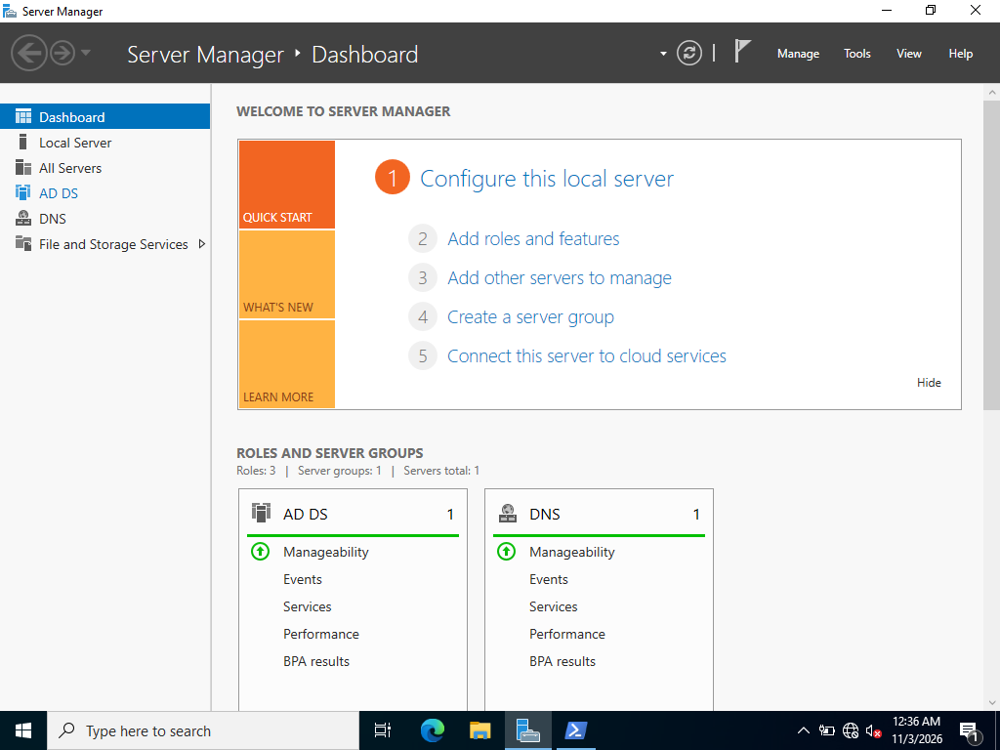
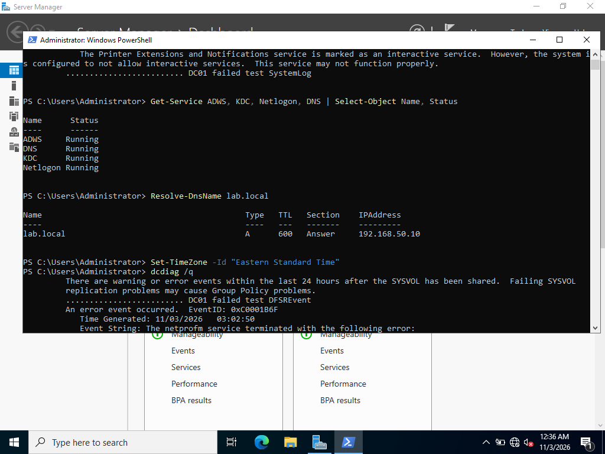
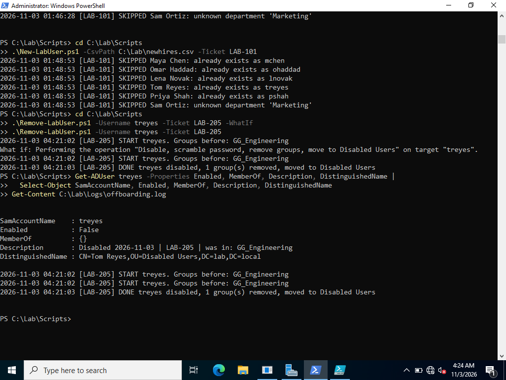
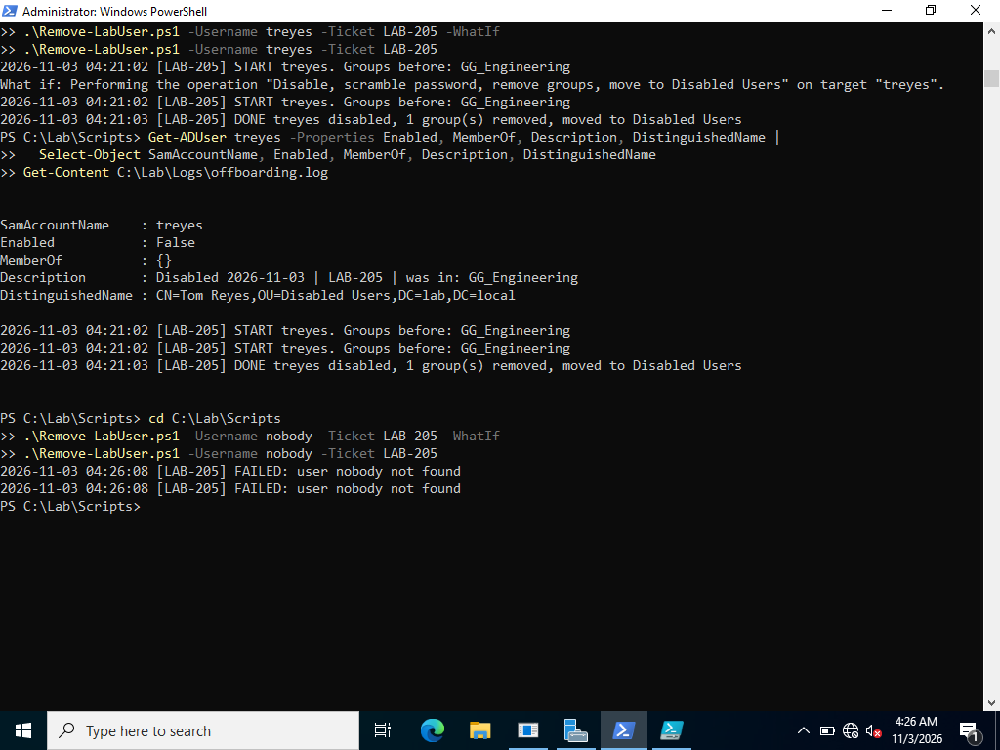
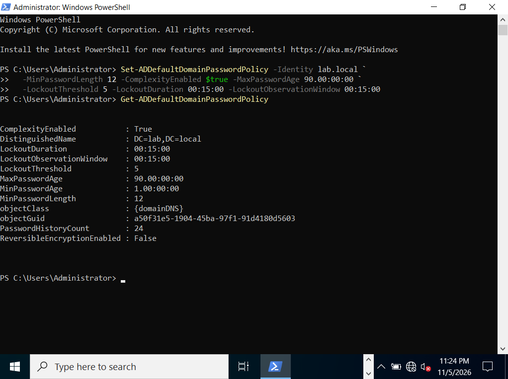
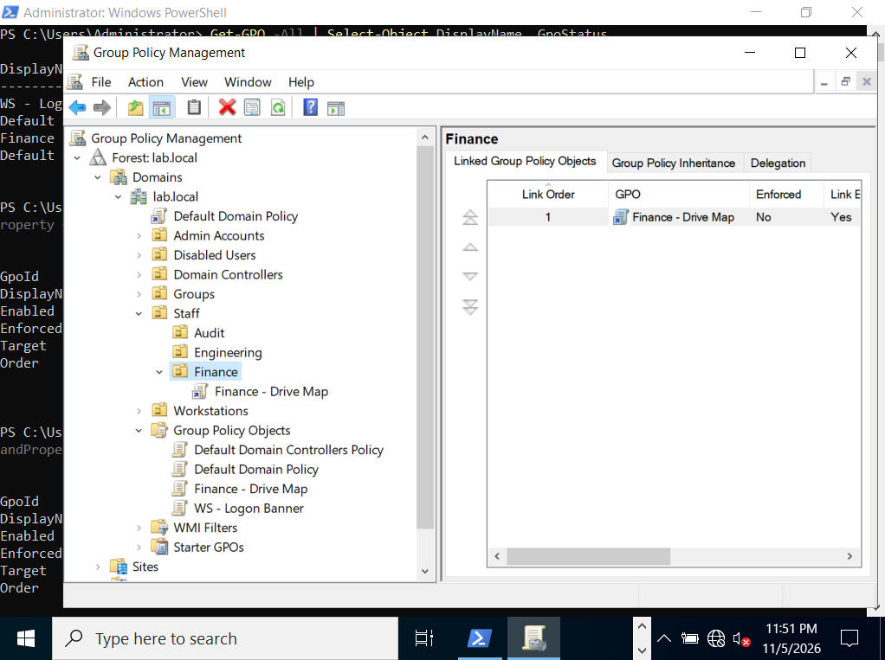
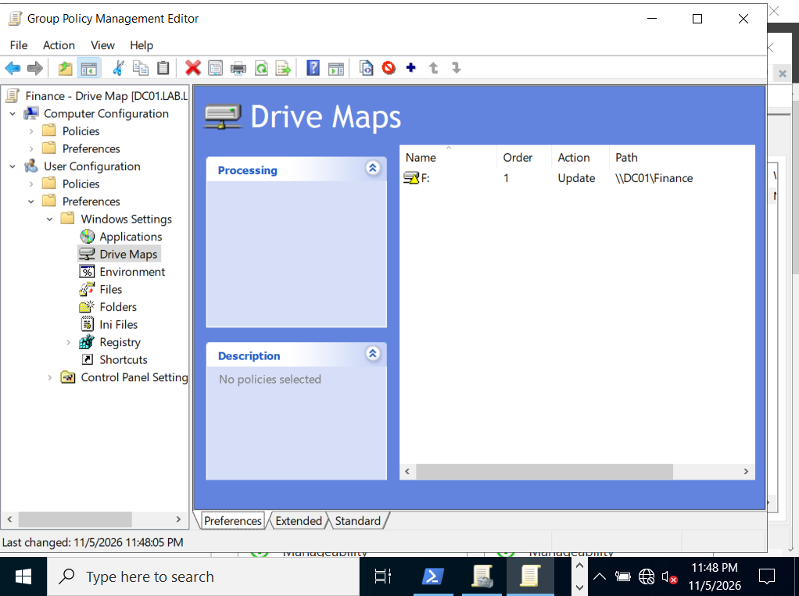
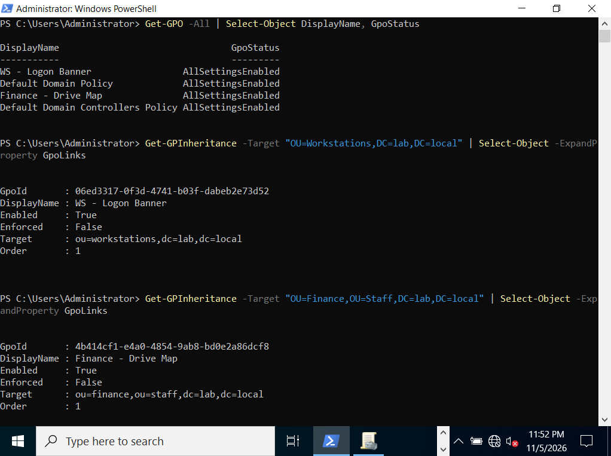

# Identity and Access Lab (Active Directory)

A Windows Server 2022 Active Directory lab built to practice the day-to-day identity work of an IT support or junior sysadmin role: user onboarding and offboarding, group-based access control, least-privilege delegation, and documenting what breaks.

Everything runs on an isolated VirtualBox network, and every change is scripted in PowerShell so the environment can be rebuilt from scratch.

## What this demonstrates

- Building a domain controller (AD DS + DNS) and designing an OU structure
- Role-based access control using the AGDLP model, with NTFS permissions granted only to resource groups
- Delegating password resets and account unlocks to a helpdesk role, scoped to standard user accounts only
- Enforcing a password and lockout policy and targeting GPOs at the right OUs
- Automating onboarding and offboarding from a CSV, with dry runs, duplicate detection, and ticket-referenced audit logs
- Diagnosing and fixing real problems that came up during the build (see [Troubleshooting log](#troubleshooting-log))

## Environment

| Component | Details |
| --- | --- |
| Hypervisor | VirtualBox on a Windows laptop |
| Server | DC01, Windows Server 2022 Standard Evaluation (Desktop Experience) |
| Domain | `lab.local` (NetBIOS: `LAB`) |
| Network | VirtualBox internal network `labnet`, 192.168.50.0/24, no internet access |
| DC01 IP | 192.168.50.10 (static), DNS points to itself |

## OU structure

```
lab.local
├── Admin Accounts        privileged and helpdesk accounts
├── Disabled Users        offboarded accounts, kept for audit and restore
├── Groups
│   ├── Resources         DL_ groups that hold permissions
│   └── Roles             GG_ groups based on job role
├── Staff
│   ├── Audit
│   ├── Engineering
│   └── Finance
└── Workstations          domain-joined computers
```

Disabled Users and Admin Accounts sit outside Staff on purpose, so the helpdesk delegation on Staff cannot reach them.

## Access model (AGDLP)

Users are never granted permissions directly. Access flows through two layers of groups:

```
User  ->  Role group (GG_)  ->  Resource group (DL_)  ->  NTFS permission
mchen ->  GG_Finance        ->  DL_FinanceShare_Modify -> Modify on C:\Shares\Finance
pshah ->  GG_Audit          ->  DL_FinanceShare_Read   -> Read on C:\Shares\Finance
```

| Role | Finance share access |
| --- | --- |
| GG_Finance | Modify |
| GG_Audit | Read only |
| GG_Engineering | None |
| GG_HelpDesk | None (reset passwords and unlock accounts in Staff only) |

Why two layers: the folder's permissions are set once and never touched again. Every future access change is a group membership change, and "who can edit the Finance share?" is answered by looking at one group.

## Scripts

| Script | Purpose |
| --- | --- |
| [`Setup-LabStructure.ps1`](scripts/Setup-LabStructure.ps1) | Builds the OUs, groups, nesting, Finance share, NTFS permissions, helpdesk account, and delegation. Safe to re-run: existing objects are skipped. |
| [`New-LabUser.ps1`](scripts/New-LabUser.ps1) | Onboards users from a CSV into the right OU and role group, with a random temporary password and forced change at first logon. |
| [`Remove-LabUser.ps1`](scripts/Remove-LabUser.ps1) | Offboards a user: disables the account, scrambles the password, records and removes group memberships, stamps the ticket number, and moves it to Disabled Users. |

All scripts run on DC01 as a domain admin.

### Onboarding

```powershell
# Preview first, then run for real
.\New-LabUser.ps1 -CsvPath ..\sample-data\newhires.csv -Ticket LAB-101 -WhatIf
.\New-LabUser.ps1 -CsvPath ..\sample-data\newhires.csv -Ticket LAB-101
```

- Usernames are first initial + last name, with a number added if the name is taken
- Rows with an unknown department are skipped and logged, not guessed
- Existing users are skipped, so the same CSV can be re-run safely
- Temporary passwords print to the console only, never to the log

### Offboarding

```powershell
.\Remove-LabUser.ps1 -Username treyes -Ticket LAB-205 -WhatIf
.\Remove-LabUser.ps1 -Username treyes -Ticket LAB-205
```

The account is disabled rather than deleted, and its description records what it had, for example:

```
Disabled 2026-11-03 | LAB-205 | was in: GG_Engineering
```

That gives an audit trail and makes it easy to restore access if the offboarding was a mistake or the person is rehired.

## Group Policy

| GPO | Linked to | What it does |
| --- | --- | --- |
| Default Domain Policy (edited) | lab.local | Password and lockout policy for every domain account |
| WS - Logon Banner | Workstations OU | Shows an "Authorized use only" notice before sign-in (computer setting) |
| Finance - Drive Map | Staff > Finance OU | Maps `\\DC01\Finance` as drive F: for Finance users (user setting) |

**Password and lockout policy**

| Setting | Value |
| --- | --- |
| Minimum length | 12 characters |
| Complexity | Required |
| Maximum password age | 90 days |
| Password history | 24 passwords remembered |
| Lockout threshold | 5 failed attempts |
| Lockout duration and observation window | 15 minutes |

```powershell
Set-ADDefaultDomainPasswordPolicy -Identity lab.local `
  -MinPasswordLength 12 -ComplexityEnabled $true -MaxPasswordAge 90.00:00:00 `
  -LockoutThreshold 5 -LockoutDuration 00:15:00 -LockoutObservationWindow 00:15:00
```

Each GPO is linked where its settings belong: the banner is a computer setting, so it targets the Workstations OU, and the drive map is a user setting, so it targets the OU the Finance users live in. GPOs follow OU location, not group membership, which is why the onboarding script places each user in their department's OU.

The banner and drive map are configured and linked, but they only take effect on a domain-joined client, which is the next step.

## Results

**Domain controller running AD DS and DNS**



**Health check: core AD services running and the domain resolving**



**Re-running onboarding skips existing users; offboarding moves the leaver to Disabled Users**



**Offboarding a user that does not exist fails cleanly**



**Domain password and lockout policy applied**



**GPOs linked to their OUs in Group Policy Management**



**Finance drive map: F: mapped to the Finance share**



**Verifying both GPOs exist and are linked to the right OUs**



Sample logs from these runs are in [`logs/`](logs/).

## Troubleshooting log

Problems hit during the build, and how each was fixed:

| Problem | Cause | Fix |
| --- | --- | --- |
| VM went back to Windows Setup after the install finished | ISO was still attached, so the VM booted from it again | Removed the ISO from the virtual optical drive |
| `New-SmbShare` failed: "No mapping between account names and security IDs" | Used `LAB\Authenticated Users`, but Authenticated Users is a built-in Windows identity, not a domain object | Used `NT AUTHORITY\Authenticated Users` |
| Share permissions showed an unresolved `S-1-5-21-...-1108` entry | A security group was deleted and recreated. Permissions are stored by SID, so the old entry pointed to a group that no longer existed | Removed the orphaned entry from the ACL with `Get-Acl` / `Set-Acl` and granted the new group |
| Finance users would have been denied access to their own share | `DL_FinanceShare_Modify` lost its `GG_Finance` member | Caught during verification, re-added the nesting |
| `New-ADUser` failed: "The object name has bad syntax" | `$base` was empty after a restart, so the OU path was incomplete | Redefined the variable; moved setup into a script that defines its own variables |

Biggest takeaway: recreating a group with the same name does not restore its access, because Windows tracks the SID, not the name.

## Status and next steps

- [x] Domain controller, DNS, OU structure
- [x] AGDLP groups, Finance share, helpdesk delegation
- [x] Onboarding and offboarding scripts
- [x] Group Policy: password and lockout policy, logon banner, Finance drive map
- [ ] Domain-joined Windows 11 client to confirm the banner and drive map apply (`gpresult /r`)
- [ ] Break tests: account lockout, access denied, helpdesk permission limits, restoring an offboarded user
- [ ] Runbooks and KB articles
- [ ] Small fix: tag `-WhatIf` runs in the logs so dry-run entries are not mistaken for real changes

## Repo structure

```
identity-access-lab/
├── README.md
├── scripts/
│   ├── Setup-LabStructure.ps1
│   ├── New-LabUser.ps1
│   └── Remove-LabUser.ps1
├── sample-data/
│   └── newhires.csv
├── logs/
│   ├── onboarding.log
│   └── offboarding.log
└── screenshots/
    ├── 01.png
    ├── 02.png
    ├── 06.png
    ├── 07.png
    ├── 10.png
    ├── 13.png
    ├── 14.png
    └── 15.png
```

All names, users, and data in this lab are fictional.